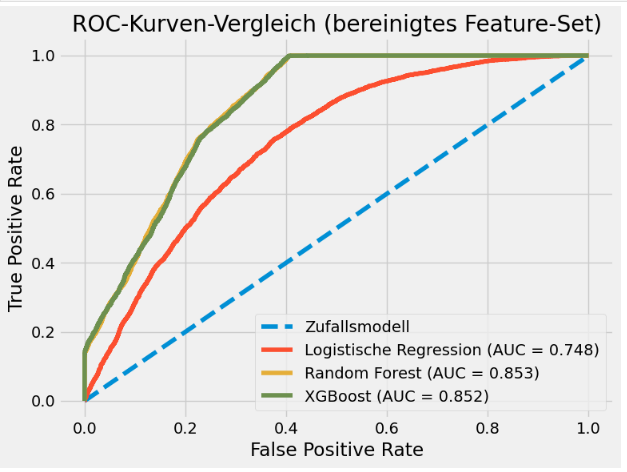
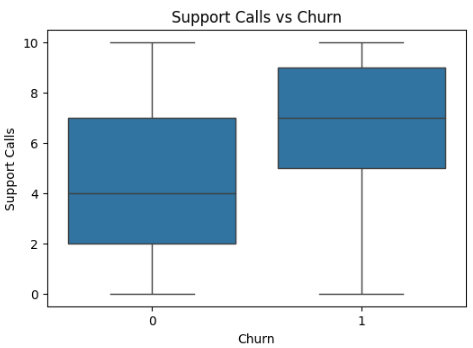

# Customer Churn Prediction – Data Science Projekt

## Projektübersicht

Dieses Projekt befasst sich mit der Vorhersage von **Customer Churn** (Kundenabwanderung) mithilfe datengetriebener Methoden.  
Ziel ist es, abwanderungsgefährdete Kunden frühzeitig zu identifizieren, zentrale Einflussfaktoren zu analysieren und daraus **praxisrelevante Handlungsempfehlungen** für das Kundenmanagement abzuleiten.

Der Fokus liegt dabei nicht nur auf der reinen Modellleistung, sondern auch auf **Interpretierbarkeit**, **Modellvalidität** und der **Übertragbarkeit der Ergebnisse auf reale Business-Szenarien**.

---

## Zentrale Visualisierungen

### Verteilung der Zielvariable


### ROC-Kurven-Vergleich


### Feature Importances – Random Forest


### EDA example


---

## Ziele des Projekts

- Entwicklung eines **binären Klassifikationsmodells** zur Vorhersage von Customer Churn  
- Identifikation zentraler **Churn-Treiber** aus Nutzungs-, Service- und Vertragsmerkmalen  
- Vergleich unterschiedlicher Modellansätze hinsichtlich **Performance und Interpretierbarkeit**  
- Ableitung **konkreter Handlungsempfehlungen** für Customer Retention  
- Sensibilisierung für typische Fallstricke wie **Informationsleckage (Data Leakage)**  

---

## Datengrundlage

Der im Repository enthaltene Datensatz stellt ein **kleines Sample** dar und dient ausschließlich der Demonstration der Datenstruktur und der Reproduzierbarkeit des Codes.

- **64.374 Kundenbeobachtungen**
- **12 Merkmale** (numerisch & kategorial)
- Zielvariable: `Churn` (0 = Kunde bleibt, 1 = Kunde wandert ab)
- Der Datensatz ist **synthetisch**, bildet jedoch realistische Strukturen typischer Kundenbeziehungen ab

> Hinweis: Der Fokus des Projekts liegt auf Methodik, Modellierung und Interpretation – weniger auf absoluten Kennzahlen.

---

## Methodischer Ansatz

Das Projekt folgt einem klassischen, praxisnahen Data-Science-Workflow:

1. Explorative Datenanalyse (EDA)  
2. Feature Engineering & Datenvorverarbeitung  
3. Modellierung und Hyperparameter-Optimierung  
4. Modellbewertung anhand geeigneter Metriken  
5. Interpretation der Ergebnisse und Business-Einordnung  

Besonderes Augenmerk wurde auf die **Identifikation und Bereinigung potenzieller Informationsleckage** gelegt, um realistische Modellbewertungen sicherzustellen.

---

## Eingesetzte Modelle

| Modell | Zweck |
|------|------|
| **Logistische Regression** | Interpretierbares Baseline- und Erklärmodell |
| **Random Forest** | Operatives Hauptmodell mit hoher Sensitivität |
| **XGBoost** | Leistungsstarkes Vergleichsmodell (Gradient Boosting) |

Alle Modelle wurden auf dem **gleichen leakage-bereinigten Feature-Set** trainiert, um eine faire Vergleichbarkeit zu gewährleisten.

---

## Zentrale Ergebnisse

- **Ensemble-Modelle** (Random Forest, XGBoost) erzielen eine deutlich höhere Trennschärfe als lineare Modelle  
- Der **Random Forest** bietet das beste Verhältnis aus Recall und ROC-AUC und eignet sich am besten für den operativen Einsatz  
- Die **logistische Regression** liefert wertvolle Einblicke in die wichtigsten Churn-Treiber und dient als erklärbares Referenzmodell  
- Besonders relevante Einflussfaktoren:
  - Support Calls
  - Vertragslaufzeit (Tenure)
  - Nutzungsfrequenz
  - Zahlungsbezogene Merkmale

---

## Modellentscheidung

- **Operatives Modell:** Random Forest  
  - Sehr hoher Recall (nahezu alle Abwanderer werden erkannt)
  - Gute Trennschärfe bei realistischen Leistungskennzahlen
  - Robust nach expliziter Leakage-Bereinigung

- **Erklärmodell:** Logistische Regression  
  - Hohe Interpretierbarkeit
  - Transparente Ableitung von Einflussfaktoren (Odds Ratios)
  - Gut geeignet für Kommunikation mit Fachabteilungen & Management

---

## Handlungsempfehlungen (Kurzfassung)

- Proaktive Betreuung bei häufigen Support-Anfragen  
- Intensives Onboarding bei kurzer Kundenbindung  
- Überwachung von Nutzungssignalen als Frühwarnindikatoren  
- Gezielte Steuerung von Vertragslaufzeiten  
- Segmentierung der Kunden nach Churn-Risiko statt Pauschalmaßnahmen  

---

## Limitationen

- Synthetischer Datensatz  
- Keine explizite Zeitachse oder Survival-Analyse  
- Keine betriebswirtschaftliche Kostenfunktion  
- Aggregierte Features statt granularer Verlaufsdaten  

Diese Aspekte bieten gleichzeitig Ansatzpunkte für zukünftige Erweiterungen.

---

## Ausblick

Mögliche Weiterentwicklungen für einen produktiven Einsatz:

- Integration einer Kostenfunktion zur optimalen Schwellenwertwahl  
- Zeitabhängige Modellansätze (z. B. Survival Analysis)  
- Nutzung detaillierter Nutzungs- und Interaktionslogs  
- Regelmäßiges Re-Training und Modell-Monitoring  

---

## Tech Stack

- **Python**
- pandas, numpy
- scikit-learn
- xgboost
- matplotlib / seaborn
- Jupyter Notebook

---

## Projektstruktur
```
├── customer_churn_prediction.ipynb
├── README.md
├── figures/
│   ├── churn_distribution.png
│   ├── roc_comparison.png
│   ├── rf_feature_importance.png
│   └── eda_example.png
└── data/
     └── sample_customer_churn.csv
```  
---

## Fazit

Das Projekt zeigt, wie datengetriebene Modelle nicht nur zur Vorhersage von Kundenabwanderung eingesetzt werden können, sondern auch als **fundierte Entscheidungsgrundlage** für strategische und operative Customer-Retention-Maßnahmen dienen.

Der Fokus auf Modellvalidität, Interpretierbarkeit und Business-Relevanz macht das Projekt gut übertragbar auf reale Anwendungsfälle.
