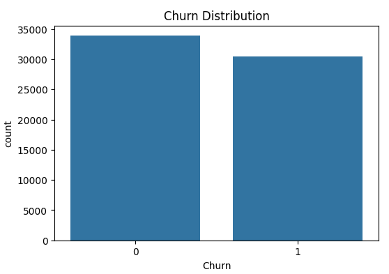
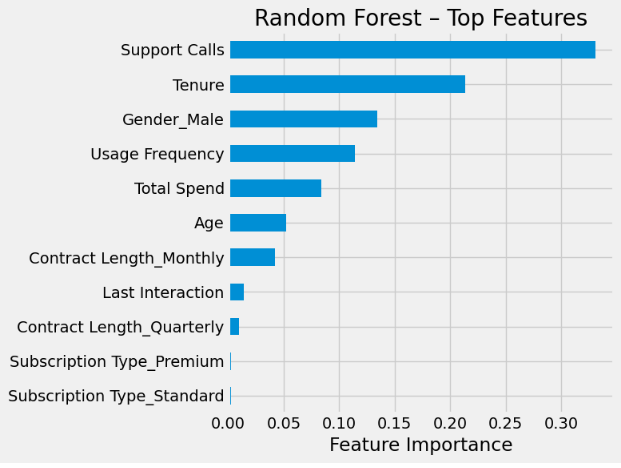

# Customer Churn Prediction – Data Science Projekt

## Projektübersicht

Dieses Projekt befasst sich mit der Vorhersage von **Customer Churn** (Kundenabwanderung) mithilfe datengetriebener Methoden.  
Ziel ist es, abwanderungsgefährdete Kunden zu identifizieren, zentrale Einflussfaktoren zu analysieren und daraus mögliche Ansatzpunkte für das Kundenmanagement abzuleiten.

Der Fokus liegt dabei nicht nur auf der Modellleistung, sondern auch auf **Interpretierbarkeit**, **Modellvalidierung** und der kritischen Einordnung der Ergebnisse.

---

## Zentrale Visualisierungen

### Verteilung der Zielvariable


### ROC-Kurven-Vergleich


### Feature Importances – Random Forest


### EDA example


---

## Ziele des Projekts

- Entwicklung eines **binären Klassifikationsmodells** zur Vorhersage von Customer Churn  
- Analyse zentraler **Churn-Treiber** aus Nutzungs-, Service- und Vertragsmerkmalen 
- Vergleich unterschiedlicher Modellansätze hinsichtlich **Performance und Interpretierbarkeit**  
- Ableitung möglicher **Handlungsansätze für Customer Retention** 
- Untersuchung ungewöhnlich hoher Modellleistungen und möglicher **Informationsleckage (Data Leakage)**  

---

## Datengrundlage

Die Analyse basiert auf einem Datensatz mit:

- **64.374 Kundenbeobachtungen**
- **12 Merkmale** (numerisch & kategorial)
- Zielvariable: `Churn` (0 = Kunde bleibt, 1 = Kunde wandert ab)
- Der Datensatz ist **synthetisch**, bildet jedoch realistische Strukturen typischer Kundenbeziehungen ab

Der Datensatz ist höchstwahrscheinlich synthetisch generiert und enthält typische Merkmale aus dem Kontext von Kundenbeziehungen, darunter Nutzungsverhalten, Support-Anfragen, Vertragsinformationen und Zahlungsdaten.
Das Repository enthält lediglich ein kleines Sample zur Demonstration der Datenstruktur.

> Hinweis: Aufgrund des synthetischen Datensatzes sind die absoluten Modellkennzahlen weniger aussagekräftig als die methodische Vorgehensweise, der Modellvergleich und die kritische Prüfung der Ergebnisse.

---

## Methodischer Ansatz

Das Projekt folgt einem klassischen, praxisnahen Data-Science-Workflow:

1. Explorative Datenanalyse (EDA)  
2. Datenvorverarbeitung und Feature Engineering 
3. Modellierung und Hyperparameter-Optimierung 
4. Modellbewertung anhand geeigneter Metriken 
5. Untersuchung ungewöhnlich hoher Modellleistungen
6. Vergleich der Modelle auf einem einheitlichen Feature-Set
7. Interpretation und Business-Einordnung der Ergebnisse 

Ein besonderer Fokus lag auf der Frage, warum das initiale Random-Forest-Modell nahezu perfekte Modellkennzahlen erreichte.

Dazu wurde untersucht, wie sich die Modellleistung verändert, wenn einzelne Merkmale jeweils aus dem Feature-Set entfernt werden.

Dabei zeigte insbesondere Payment Delay einen außergewöhnlich starken Einfluss auf die Modellleistung. Nach dessen Ausschluss sank die ROC-AUC deutlich auf etwa 0,85.

Dies allein beweist jedoch keine Informationsleckage. Da der Datensatz keine eindeutige zeitliche Struktur enthält, kann nicht abschließend beurteilt werden, ob Payment Delay zum tatsächlichen Zeitpunkt einer Churn-Prognose bereits verfügbar gewesen wäre.

Für die weiteren Modellvergleiche wurde dieses Merkmal daher vorsorglich ausgeschlossen.

---

## Eingesetzte Modelle

| Modell | Zweck |
|------|------|
| **Logistische Regression** | Interpretierbares Baseline- und Erklärmodell |
| **Random Forest** | Operatives Hauptmodell mit hoher Sensitivität |
| **XGBoost** | Leistungsstarkes Vergleichsmodell (Gradient Boosting) |

Alle Modelle wurden auf dem **gleichen leakage-bereinigten Feature-Set** trainiert, um eine faire Vergleichbarkeit zu gewährleisten.

---

## Zentrale Ergebnisse

- Im vorliegenden Datensatz erzielen **Random Forest und XGBoost** eine höhere Trennschärfe als die logistische Regression.
- Der **Random Forest** erreicht im abschließenden Modellvergleich eine starke Kombination aus Recall, F1-Score und ROC-AUC. 
- Die **logistische Regression** bietet zusätzliche Vorteile hinsichtlich Interpretierbarkeit und Nachvollziehbarkeit der Einflussfaktoren.
- Der starke Einfluss von Payment Delay zeigt, wie wichtig es ist, ungewöhnlich gute Modellleistungen kritisch zu hinterfragen.
- Weitere relevante Merkmale im Datensatz sind unter anderem:
  - Support Calls
  - Vertragslaufzeit (Tenure)
  - Nutzungsfrequenz
  - Zahlungsbezogene Merkmale

---

## Modellentscheidung

- **Random Forest** 
  - sehr hoher Recall auf dem vorliegenden Testdatensatz
  - gute Trennschärfe nach Ausschluss von Payment Delay
  - kann nichtlineare Zusammenhänge und Interaktionen abbilden
  - stärkste Gesamtperformance im vorliegenden Modellvergleich

- **Logistische Regression**
  - Hohe Interpretierbarkeit
  - transparente Analyse der Einflussfaktoren über Koeffizienten und Odds Ratios
  - sinnvolles Baseline- und Erklärmodell
    
-  **XGBoost** 
  - leistungsfähiges Gradient-Boosting-Verfahren
  - gute Performance auf strukturierten Tabellendaten
  - zusätzliche Vergleichsbasis zum Random Forest

---

## Mögliche Handlungsansätze

Die Modellergebnisse liefern Hinweise auf mögliche Ansatzpunkte für Customer-Retention-Maßnahmen, beispielsweise:
- stärkere Betreuung bei häufigen Support-Anfragen 
- gezielte Analyse von Kunden mit kurzer Vertragsdauer  
- Beobachtung von Veränderungen im Nutzungsverhalten 
- risikobasierte Segmentierung von Kunden   

---

## Limitationen

- **Synthetischer Datensatz**:
  
  Der Datensatz ist höchstwahrscheinlich synthetisch generiert. Reale Komplexitäten, Rauschen und unerwartete Verhaltensmuster können       dadurch nur eingeschränkt abgebildet werden.
  
- **Keine eindeutige zeitliche Struktur**:
  
  Die Daten enthalten keine explizite Zeitachse. Daher ist nicht eindeutig nachvollziehbar, ob Merkmale wie Payment Delay zum             tatsächlichen Zeitpunkt einer Vorhersage bereits verfügbar gewesen wären.  
Eine mögliche Informationsleckage kann deshalb nicht abschließend bestätigt oder ausgeschlossen werden.  

- **Keine betriebswirtschaftliche Kostenfunktion**:
  
  False Positives und False Negatives wurden nicht anhand konkreter finanzieller Auswirkungen bewertet.
   
- **Keine Zeitreihen- oder Survival-Analyse**:
  
  Die Aufgabe wurde als klassisches binäres Klassifikationsproblem modelliert. Die Zeit bis zur Abwanderung wurde nicht berücksichtigt.
  
- **Aggregierte Features**:
  
  Die verwendeten Merkmale bestehen überwiegend aus aggregierten Kennzahlen. Detailliertere Verlaufs- und Interaktionsdaten könnten zusätzliche Informationen liefern.
  

---

## Ausblick

Für eine Weiterentwicklung in Richtung eines realen Anwendungsszenarios wären unter anderem folgende Schritte sinnvoll:

- Validierung auf **realen und zeitlich strukturierten Kundendaten**  
- Integration einer betriebswirtschaftlichen Kostenfunktion  
- Optimierung des Entscheidungsschwellenwerts anhand konkreter Business-Ziele  
- Erweiterung um zeitabhängige Modelle, beispielsweise Survival Analysis
- Nutzung detaillierter Nutzungs- und Interaktionsdaten
- regelmäßiges Re-Training und Monitoring der Modelle 

---

## Tech Stack

- **Python**
- pandas, numpy
- scikit-learn
- xgboost
- matplotlib / seaborn
- Jupyter Notebook

---

## Projektstruktur
```
├── customer_churn_prediction.ipynb
├── README.md
├── figures/
│   ├── churn_distribution.png
│   ├── roc_comparison.png
│   ├── rf_feature_importance.png
│   └── eda_example.png
└── data/
     └── sample_customer_churn.csv
```  
---

## Fazit

Das Projekt zeigt exemplarisch, wie unterschiedliche Klassifikationsmodelle zur Analyse von Customer Churn eingesetzt und miteinander verglichen werden können.

Ein besonderer Schwerpunkt liegt auf der **kritischen Bewertung ungewöhnlich hoher Modellleistungen**. Die Untersuchung des Merkmals Payment Delay zeigt, dass gute Kennzahlen allein nicht ausreichen, sondern auch geprüft werden muss, welche Informationen einem Modell zur Verfügung stehen und ob diese in einem realen Vorhersageszenario tatsächlich verfügbar wären.

Damit verbindet das Projekt Modellierung, Interpretation und Modellvalidierung und zeigt zugleich die Grenzen auf, die vor einem produktiven Einsatz berücksichtigt werden müssten.
